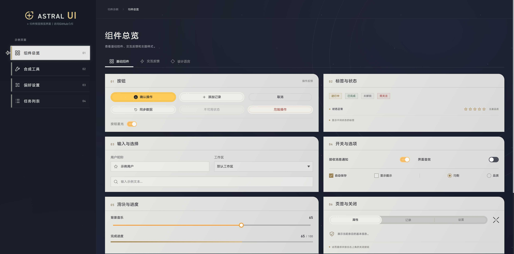
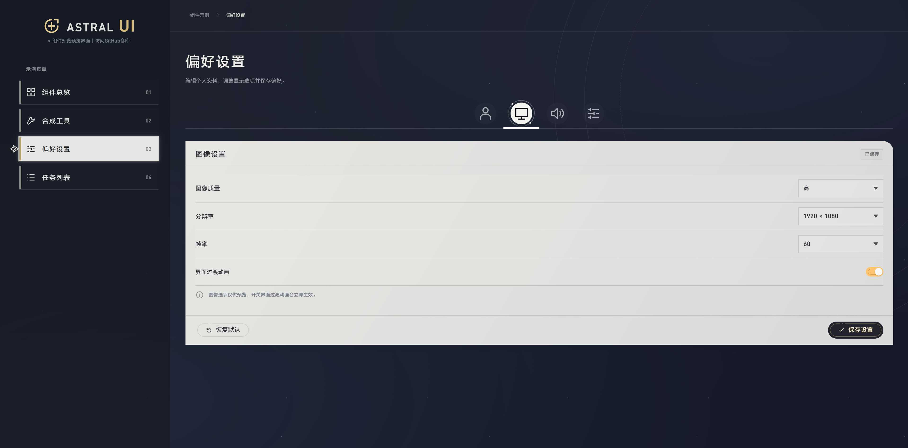
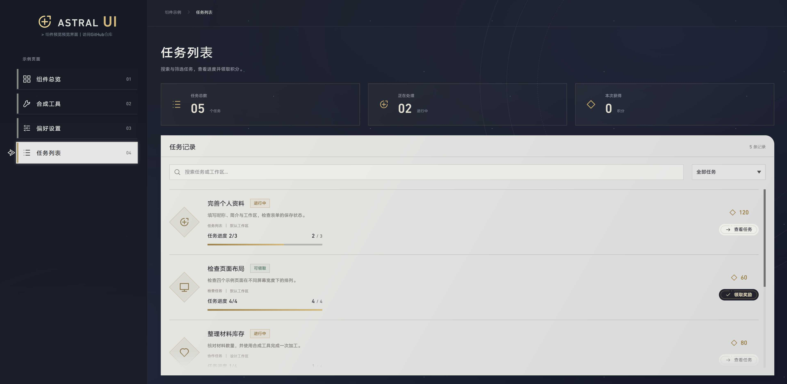
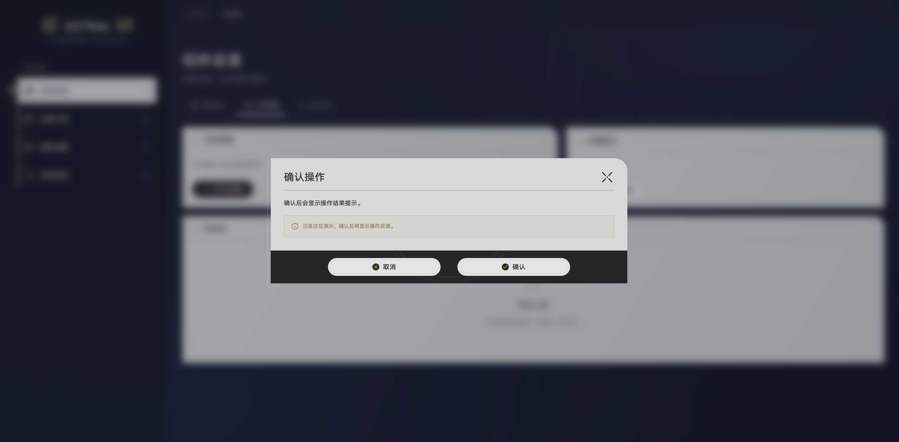

  <h1>Astral UI</h1>
  
参考知名二次元回合制游戏的界面设计, 基于 Vue 3 提供基础的交互控件

   
  

    
    
  

  

    
    
  

# 在线预览

访问本项目的 [GitHub Pages](https://d-pear.github.io/astral-ui/) 直接体验UI界面

# 使用文档

- [接入到项目](docs/getting-started.md)
- [可用组件列表](docs/components.md)
- [自定义主题](docs/theming.md)

# 关于

- 本项目仅为受到知名二次元回合制游戏启发而做出的界面设计, 与游戏本身及其发行商不存在任何关联
- 本项目不对任何下游的使用负责, 请在遵守当地的法律法规的情况下使用
